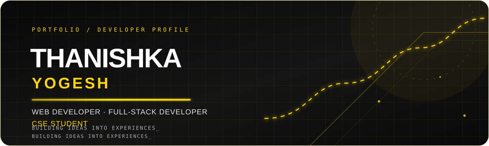
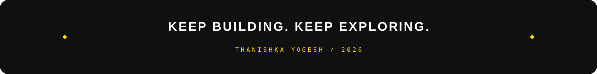

**Web Developer · Full-Stack Developer**  
**CSE Student · Creative Technologist**

I enjoy turning ideas into useful digital experiences, building for the web, and exploring how technology can solve everyday problems.

---

## `01` · About Me

- 🎓 Pursuing **B.E. Computer Science and Engineering** at **Sri Sairam Engineering College, Chennai**.
- 💻 Interested in **full-stack development, web technologies, and software engineering**.
- 🧩 I like building practical projects, experimenting with interfaces, and learning by shipping.
- 🤝 Active in student-led technical communities and event initiatives.
- 🌱 Currently strengthening my skills in programming, backend development, and building end-to-end applications.

## `02` · What I've Built

A selection of projects I've worked on, explored, and helped bring to life.

| Project | What it is | Repository |
|:--|:--|:--:|
| **Paimana AI** | An AI-focused project for infrastructure monitoring and predictive insights. | [View ↗](https://github.com/thanishkaykb/PAIMANA-AI) |
| **Silent Voices, Seen** | A browser-based platform exploring speech and sign-language translation and accessible communication. | [View ↗](https://github.com/thanishkaykb/Silent-Voices-Seen) |
| **CongestiQ AI** | An AI-powered smart traffic intelligence platform with map data, weather insights, and intelligent routing. | [View ↗](https://github.com/thanishkaykb/CongestiQ-AI) |
| **Work2Credit** | A platform concept helping independent gig workers build a portable work profile and credibility record. | [View ↗](https://github.com/thanishkaykb/WORK2CREDIT) |
| **Intellect Hack 2026** | Event website for an AI hackathon organized by IEEE Reliability Society, SEC SBC. | [View ↗](https://github.com/thanishkaykb/Intellect-Hack-2026) |
| **GreenPin Nexus** | A project exploring technology-driven ideas for greener, more sustainable communities. | [View ↗](https://github.com/thanishkaykb/Green-Pin-Nexus) |

## `03` · Tech Stack

**Languages**

**Frontend**

**Backend, Data & Tools**

## `04` · Beyond the Code

- **Outreach & Multimedia Team Lead**, IEEE TEMS Society
- **Execom Member**, IEEE TEMS Society
- **MAGIC Member**, UBA, UiAutomistix Club, UiAutomistix Club

I enjoy contributing to student communities, helping bring technical events to life, and collaborating with people who like making things happen.

## `05` · GitHub Activity

The contribution calendar displays your GitHub activity over the past year. Contribution data is provided by GitHub; the chart is rendered by the external GitHub Chart service.

## `06` · Let's Connect

**Have an idea, a project, or an interesting problem? Let's build something meaningful.**

